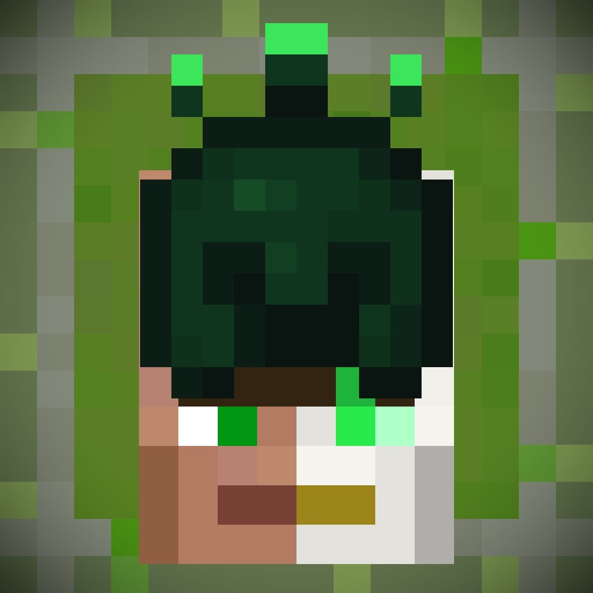

# The Village Fights Back



**After years of being destroyed by your infection mods, the villagers decided to build their own.**

The Village Fights Back is a Minecraft mod that turns ordinary villages into self-organizing strongholds.
At the heart of every village sits the **Village Brain Node**, an AI that spends the village's emeralds to
arm its people, raise walls, and evolve its defenders across **4 stages**, until the village can strike
back at whatever threatens it, players included.

Playtested against the Sculk Horde, Spore Fungal Infection, The Flesh That Hates, Phayriosis,
Abominations, and Prion.

## Features

- **The Village Brain Node** replaces the village bell and runs the whole defense: a per-village emerald
  economy, 4 evolution stages, settlers, walls and purpose-built structures (golem factories, barracks,
  lure towers), sunset reinforcements, and an immunity aura. Right-click it to see the stage, emeralds,
  unit counts, and logs.
- **Armed defenders.** Every villager fights, guards carry heavier weapons, and iron golems wield rocket
  launchers. Any mob tagged hostile is a target, so monsters from other mods are handled automatically.
- **12 weapons**, including infecting blades, a Mace with its enchantments, a rocket launcher, wind
  charges, fire grenades, and full Emerald and Limbo gear lines.
- **Walls and defenses** traced around the village's real footprint, with loopholes, Wall Defender
  turrets, reinforced and protecting glass, and smart gates that only let allies through.
- **A counter-infection.** Fertile and Rich blocks slowly spread from the Brain Node, light up the
  caves beneath the village, and feed its economy.
- **The Emerald Virus** and the **Emerald faction**, a contagion and a mob infection allied with the
  village.
- **2 bosses:** the Vindictive Village Spirit, born when a village falls, and General Darius, the
  village's living champion.
- **The Limbo**, a new dimension with its own portal, creatures, ores, gear, villager profession, and
  raid.
- **Reputation.** The village scores you, from Hero of the Village V down to Nightmare of the Village.
- **17 new creatures**, **3 potions**, **17 structures**, and a full set of advancements.
- **Optional MCA Reborn compatibility**: with it installed, the whole village becomes MCA humans.
- **Configurable.** Every setting lives in `config/thevillagefightsback-common.toml` and can be changed
  in-game with `/thevillagefightsback config <name> [value]`.

## Versions and branches

| Minecraft | Loader   | Branch             | Java |
|-----------|----------|--------------------|------|
| 1.20.1    | Forge    | `main`             | 17   |
| 1.20.1    | Fabric   | `fabric-1.20.1`    | 17   |
| 1.21.1    | NeoForge | `port-1.21.1-v150` | 21   |
| 1.19.2    | Forge    | `1.19.2`           | 17   |

The `neoforge-1.21.1`, `port-1.21.1-v130` and `port-1.19.2-v130` branches are older ports.

## Requirements

- **Guard Villagers**: required on Forge (the village's guards are built on it). Optional on NeoForge,
  and not declared on Fabric.
- **MCA Reborn**: optional.

## Building

Check out the branch for the version you want, then run:

```
./gradlew build
```

The jar is written to `build/libs/`, named after the Minecraft version
(e.g. `thevillagefightsback-1.20.1-<version>.jar`, or `thevillagefightsback-fabric-1.20.1-<version>.jar`
on Fabric).

You need JDK 17 (JDK 21 for the 1.21.1 branches). If `gradle.properties` sets `org.gradle.java.home`,
point it at your own JDK or remove that line.

## License

All Rights Reserved.

Author: LexNoWolf
